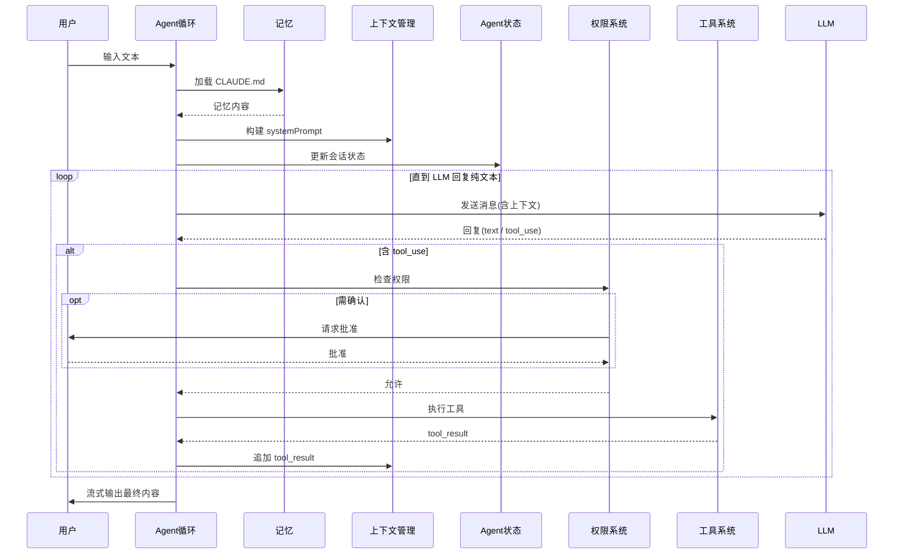

# 第1章 整体架构与启动

> **前置知识**：了解 TypeScript 基础语法，知道什么是 CLI 工具
> **关键文件**：`src/main.tsx`、`src/query.ts`、`src/Tool.ts`、`src/tools.ts`

---

## 1.1 解决什么问题

在 Claude Code 出现之前，AI 辅助编程的主流形态是**代码补全**（GitHub Copilot 等）：用户在 IDE 里写代码，AI 在光标处预测下一行。这种模式有天然的局限：

1. **单点感知**：AI 只看到当前打开的几个文件，无法理解整个项目的依赖关系。
2. **无工具调用**：AI 无法真正执行命令、读取文件、运行测试——它只能"预测文本"。
3. **无多轮交互**：Copilot 式补全是一次性的，缺乏对话式推理能力。
4. **上下文窗口太小**：早期 Copilot 只能感知约 512 个 token 的上下文，对于大型项目几乎无效。

Claude Code 的目标是构建一个**真正的编程智能体（Coding Agent）**：它能读文件、写文件、执行 Shell、调用外部工具、跨会话记忆，并且在没有用户干预的情况下完成从"我要修这个 Bug"到"代码已经 commit 并且测试通过"的完整任务链。

---

## 1.2 业界的做法

**代码补全派**（GitHub Copilot, Cursor Tab）：
- 优点：低延迟，适合"快速补全"场景
- 缺点：无任务规划能力，无法跨文件操作

**对话助手派**（ChatGPT, Claude.ai 网页版）：
- 优点：可以多轮交互，可以"思考"
- 缺点：无法真正操作文件系统，只能输出代码片段让用户手动复制

**早期 Agentic 工具**（AutoGPT, BabyAGI）：
- 优点：自主规划和执行
- 缺点：工程质量差，容易死循环，缺乏安全机制，对大代码库无能为力

**竞争者**（Cursor Agent, Copilot Workspace）：
- 优点：集成在 IDE 中，有文件系统访问
- 缺点：闭源，可扩展性差，不支持自定义工具

---

## 1.3 整体架构：四层结构

读完代码，可以归纳出一个清晰的四层架构：

```
┌─────────────────────────────────────────────────────────────┐
│                      第四层：用户界面                         │
│   TUI (ink/React)  │  SDK (QueryEngine API)  │  CLI (print) │
├─────────────────────────────────────────────────────────────┤
│                      第三层：会话管理                         │
│           QueryEngine  ←→  query.ts (主循环)                 │
├─────────────────────────────────────────────────────────────┤
│                    第二层：工具与智能体                        │
│  BashTool  FileReadTool  GrepTool  AgentTool  SkillTool  MCP│
├─────────────────────────────────────────────────────────────┤
│                      第一层：基础设施                         │
│  Anthropic API │ 权限系统 │ 上下文管理 │ 存储 │ 分析/遥测     │
└─────────────────────────────────────────────────────────────┘
```

每一层的核心职责：

| 层级 | 关键模块 | 核心职责 |
|------|----------|----------|
| 用户界面 | `main.tsx`, `ink/` | 命令行交互、React 组件渲染到终端 |
| 会话管理 | `QueryEngine.ts`, `query.ts` | 管理对话状态、驱动智能体循环 |
| 工具与智能体 | `tools/`, `tasks/` | 实现 AI 可调用的每个能力 |
| 基础设施 | `services/`, `utils/` | API 调用、权限、压缩、存储 |

---

## 1.4 信息流：一次输入如何变成代码修改

以用户输入 `"帮我修复 src/utils.ts 里的 bug"` 为例，整个请求链路：

```
1. 用户按下回车
   │
   ▼
2. main.tsx: processUserInput()
   │  解析命令/普通消息
   │  判断是否是 /slash 命令
   │
   ▼
3. QueryEngine.ts: processUserTurn()
   │  构造 UserMessage
   │  加载记忆文件（CLAUDE.md）
   │  构建 systemPrompt
   │
   ▼
4. query.ts: query() → queryLoop()    ← 核心 Agentic Loop
   │
   │  ① 发送消息给 Claude API（流式）
   │  ② 接收 AI 回复（可能含 tool_use 块）
   │  ③ 执行工具：
   │     ├── FileReadTool("src/utils.ts")    → 读取文件内容
   │     ├── GrepTool("error pattern")       → 搜索错误模式
   │     └── FileEditTool("修复内容")         → 写入修复
   │  ④ 把工具结果作为 tool_result 送回 AI
   │  ⑤ AI 决定：继续？还是任务完成？
   │  ⑥ 如果继续，重新执行 ②
   │
   ▼
5. 流式输出到终端 / SDK
```

以上是高层信息流。更精确的**对象间时序图**如下（覆盖用户、Agent 循环、记忆、上下文管理、Agent 状态、权限系统、工具系统、LLM 八个对象）：



**核心结论**：LLM 只负责「想」，工具只负责「做」，权限卡在「做」之前，Agent 循环是来回传话的中间人。

---

## 1.5 Agent 的流式事件管道与工具输入校验容错

### 流式事件驱动：AsyncGenerator 作为事件管道

`query.ts` 里核心的 `query()` 函数签名：

```typescript
export async function* query(
  params: QueryParams,
): AsyncGenerator<
  | StreamEvent
  | RequestStartEvent
  | Message
  | TombstoneMessage
  | ToolUseSummaryMessage,
  Terminal
>
```

它不是普通函数，而是**异步生成器函数**（`async function*`）。调用方用 `for await (const event of query(...))` 来消费流式事件：

```typescript
// 消费方（简化示意）
for await (const event of query(params)) {
  if (event.type === 'assistant') {
    // 流式渲染 AI 回复
    renderText(event.content)
  } else if (event.type === 'tool_result') {
    // 显示工具执行结果
    renderToolResult(event)
  }
}
```

这种设计的好处：
1. **背压控制**：消费者来不及处理时，生产者自动暂停（yield 挂起）
2. **资源复用**：整个智能体循环复用同一个 HTTP 连接的流式传输
3. **透明性**：调用方不需要知道内部是单轮还是多轮——它只关心事件流

### 工具输入校验容错：Zod Schema

Agent 的每一个工具调用参数都由 LLM 生成，天然不可信。项目大量使用 [Zod](https://zod.dev/) 定义工具输入 schema，在运行时做校验与容错：

```typescript
// 工具输入 schema 示例（GrepTool）
const inputSchema = z.strictObject({
  pattern: z.string().describe('The regular expression pattern'),
  path: z.string().optional(),
  output_mode: z.enum(['content', 'files_with_matches', 'count']).optional(),
  // ...
})
```

Zod 在 Agent 系统中承担三重职责：
1. **运行时校验**：`inputSchema.safeParse(aiInput)` 拦截格式错误的工具参数，把校验错误回传给 LLM 而不是直接崩溃（容错）
2. **TypeScript 类型推断**：`z.infer<typeof inputSchema>` 自动生成 TS 类型，工具实现拿到的是强类型输入
3. **Schema 即提示词**：`.describe()` 注释会作为 tool schema 的一部分发给 AI，告诉 AI 每个参数的含义——校验规则同时也在"教" LLM 怎么正确调用工具

---

## 1.6 启动流程：Agent 系统如何就绪

Agent 在接受第一条消息之前，需要完成三类与 Agent 能力直接相关的准备：**装配工具系统**、**加载项目记忆**、**接入外部工具（MCP）**。完整链路如下：

```
main.tsx 入口
    │
    ├── 解析命令行参数 (Commander.js)
    │
    ├── init()  ←── entrypoints/init.ts
    │   └── 基础配置与环境初始化
    │
    ├── 加载工具系统
    │   └── getTools(config)                 // 按 feature flag 组装工具列表
    │
    ├── 连接 MCP 服务器
    │   └── 并行连接所有配置的 MCP servers
    │       ├── stdio 传输（子进程）
    │       ├── SSE 传输（HTTP 长连接）
    │       └── WebSocket 传输
    │
    └── 启动 REPL
        └── launchRepl() → ink React 渲染
```

### 工具装配：getTools()

工具系统在启动时被集中初始化。`tools.ts` 的 `getTools()` 函数按 feature flag 和用户类型决定哪些工具可用：

```typescript
// tools.ts（简化）
export function getTools(config: ToolsConfig): Tools {
  const tools: Tool[] = [
    BashTool,
    FileReadTool,
    FileEditTool,
    FileWriteTool,
    GlobTool,
    GrepTool,
    // ... 约 40 个工具
  ]

  // 仅 ant（Anthropic 内部）用户可用的工具
  if (process.env.USER_TYPE === 'ant') {
    if (REPLTool) tools.push(REPLTool)
    if (SuggestBackgroundPRTool) tools.push(SuggestBackgroundPRTool)
  }

  // 仅特定 feature flag 开启时可用
  if (SleepTool) tools.push(SleepTool)
  if (cronTools.length) tools.push(...cronTools)

  // MCP 动态工具（从连接的 MCP 服务器获取）
  tools.push(...mcpTools)

  return uniqBy(tools, t => t.name)
}
```

注意 `uniqBy(tools, t => t.name)` 去重，防止重名工具导致 AI 调用混乱。feature flag 在这里的作用是**控制 Agent 的能力边界**：flag 未开启的工具不会进入工具列表，AI 从一开始就"不知道"这个能力存在，而不是调用时才被拒绝。

### 项目记忆加载：CLAUDE.md

启动时会扫描工作目录下的 `CLAUDE.md` 文件（以及父目录中的同名文件），作为"项目记忆"注入到系统提示：

```typescript
// utils/memdir/memdir.ts（简化）
export async function loadMemoryPrompt(cwd: string): Promise<string> {
  // 查找 CLAUDE.md 文件的路径层级
  const paths = [
    path.join(cwd, 'CLAUDE.md'),           // 项目级
    path.join(homedir(), 'CLAUDE.md'),     // 用户全局级
    // ... 还有中间目录
  ]

  const contents = await Promise.all(
    paths.map(p => readFile(p).catch(() => null))
  )

  return contents.filter(Boolean).join('\n\n---\n\n')
}
```

`CLAUDE.md` 的内容会附加到系统提示末尾，告诉 AI 项目的特定约定（比如"这个项目用 bun 不用 npm"、"所有提交必须通过 lint 检查"）。这是 Agent 适配具体项目环境的主要机制之一。

### 外部工具接入：MCP 服务器连接

启动时并行连接所有配置的 MCP 服务器（stdio / SSE / WebSocket 三种传输），连接成功后，每个 MCP Server 暴露的工具会被适配成 Claude Code 的 `Tool` 接口，合并进 `getTools()` 的工具列表。对 Agent 而言，MCP 工具与内置工具在调用方式上完全一致。

---

## 1.7 优势与不足

### 与业界对比的优势

| 维度 | 业界做法 | 本项目做法 | 本项目优势 |
|------|----------|------------|------------|
| 工具并发 | 串行执行 | 按只读/写操作智能并发 | 多文件操作快 2-5x |
| 上下文管理 | 手动截断或不管理 | 自动压缩（AI 生成摘要）| 无感知地处理超长会话 |
| 权限控制 | 无 / 全信任 | 五级权限模型 + Hooks | 安全与效率平衡 |
| 工具扩展 | 需要 fork 代码 | MCP 协议 + 插件系统 | 生态开放 |
| SDK 复用 | CLI 工具不可嵌入 | QueryEngine 提供 SDK 接口 | 可被 IDE 插件复用 |
| 特性管理 | 维护多个分支 | Bun DCE + Feature Flag | 一套代码，多个版本 |

### 不足

1. **`query.ts` 过度耦合**：约 1700 行的 `queryLoop` 函数把状态机、压缩、错误恢复、token 追踪全部耦合，极难维护。
2. **Tool 接口过于复杂**：约 40 个方法/属性，对新工具开发者来说学习曲线陡峭。
3. **MCP 连接阻塞工具可用性**：启动时需要等待所有 MCP 服务器连接完成（或超时）后工具列表才完整。如果用户配置了慢速/不稳定的 MCP 服务器，Agent 的可用工具会延迟就绪。更好的方案是"乐观启动"——先启动 REPL，MCP 工具在后台接入，连接成功后再增量更新工具列表。
4. **无本地缓存语义索引**：目前的代码搜索依赖 ripgrep（文本搜索），没有持久化的 AST 索引，对于"找到所有实现了接口 X 的类"这类语义查询效率较低。
