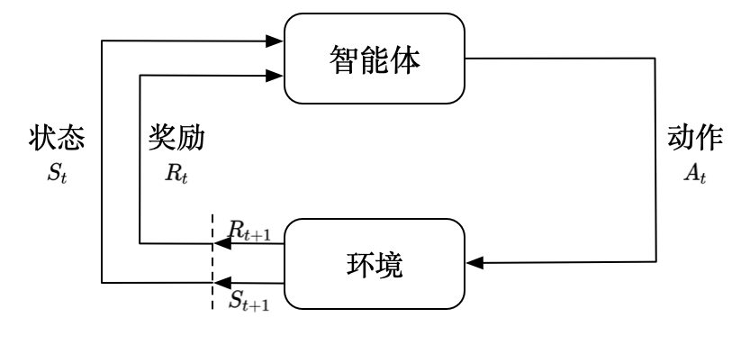

# 以Claude Code 为例讲述agent设计哲学

> **面向读者**： 对agent感兴趣的同学

> **总体思路**： 
从强化学习的视角理解agent: agent的本质是根据环境(State)，采取一些行为(Tool)，得到一些反馈(ToolOutput)，从而不断调整自己的策略(Learning)，最终实现目标(Goal), llm具有随机的特性，由于采取了llm作为决策中心，harness系统为了降低这种随机性，从刚才那几个组件中，设计出很多确定性的步骤。

强化学习视角: agent系统与强化学习对比：



| 模块对比 |定义 |基于llm的agent | 基于强化学习的agent |
|------|------|------|----------|
| agent | 如何输出action｜llm | 训练的模型 |
| Reward | 做的好不好|反思/验证 | reward model |
| 环境 | 智能体交互对象|个人电脑 | 游戏世界 | 
| 状态 | 智能体能感知到的世界|环境+记忆系统| 通过特征工程进行representation | 
| 动作 |能采取的动作 | tool | 定义好的action |

**软件工程的视角**：
**agent本质还是软件**: 老的软件是hard code的硬逻辑，给定固定输入，输出的逻辑，都是代码写死的。基于llm的系统，给定固定输入，可以通过llm自主决策执行程序的逻辑， 可以组合执行不同的程序块。

**harness**: 但是llm的输出是随机的，所有需要通过harness系统，在关键节点进行hard code， 降低输出不确定性。

**harness之prompt工程**: 本质提升llm的输出正确结果的概率的，原生query输入进去有可能执行的是不是我们想要的逻辑, 所有通过prompt 工程、COT、few shot learning等, 让llm的输出更加确定。

**harness之context engineering**: 更复杂一点的场景，需要不断跟agent进行对话，但是llm的输入窗口是有限的，所有会出现context engineering这个概念，解决的是固定输入窗口的时候，该挑选什么放进窗口内。

**harness之Rag系统**: 另一方面，llm的知识是固化在模型参数里面的，用户问llm最新的或者私有的信息，就束手无策了，比如问某个公司最新的财报, 所以需要通过Rag/graphRag系统构造知识给llm(难点是给喂什么样的知识，多余的知识可能会干扰决策，少的知识造成决策信息不足)。

**harness之memory**: 为了实现个性化，老的软件系统，比如电商场景、推荐场景，使用的是用户行为建模技术，把用户历史行为作为特征输入，通过深度学习模型进行预测，实现对用户在系统中留下的痕迹进行个性化反馈。 agent系统也有同样的需求，但是面对问题更复杂，输入和输出都是开放域的个性化问题，数据是非结构化的，而且只有一次回答机会（搜广推系统可以展示多个），这类问题统一归结成memory问题。

**harness之task orchestration**: 任务编排，agent系统需要解决的问题是如何更确定的把多个工具组合起来，完成一个任务。

**harness之安全**: 软件具有执行不确定性，所以需要设计安全机制，比如权限管理、沙箱机制等，保证对操作环境或者用户的数据、安全这些不造成损害

**harness之Recursive self-improvement(RSI)**: 上述模块对不同的系统，都有不同的需求，所以需要通过RSI系统，把上述模块进行自动调优，形成更强的agent系统。

本书将以Claude Code 为例，讲述agent设计哲学。
---

## 章节目录

| 章节 | 主题 | 核心文件 |
|------|------|----------|
| [第1章](./01-agent-architecture.md) | 整体架构与启动 | `main.tsx`, `query.ts`, `Tool.ts`, `tools.ts` |
| [第2章](./02-query-engine.md) | QueryEngine 对话引擎 | `QueryEngine.ts` |
| [第3章](./03-agentic-loop.md) | Agentic Loop 智能体核心循环 | `query.ts`, `services/tools/toolOrchestration.ts` |
| [第4章](./04-tool-system.md) | 工具系统：让 AI 拥有手 | `Tool.ts`, `tools.ts`, `tools/GrepTool/` |
| [第5章](./05-permissions.md) | 权限系统：安全边界 | `types/permissions.ts`, `hooks/` |
| [第6章](./06-task-orchestration.md) | 任务编排 | `tools/AgentTool/`, `tasks/` |
| [第7章](./07-context-management.md) | 上下文管理与自动压缩 | `services/compact/`, `utils/tokens.ts` |
| [第8章](./08-memory-system.md) | 记忆系统：让 AI 跨会话学习 | `memdir/`, `services/SessionMemory/` |
| [第9章](./09-mcp-integration.md) | MCP 协议集成 | `services/mcp/` |
| [第10章](./10-session-persistence.md) | 会话持久化与恢复 | `utils/sessionStorage.ts`, `QueryEngine.ts` |
| [第11章](./11-permission-modes.md) | 权限模式详解：从 Plan 到 Auto | `types/permissions.ts`, `tools/EnterPlanModeTool/` |
| [第12章](./12-state-management.md) | 状态管理：极简自研 Store | `state/store.ts`, `state/AppStateStore.ts`, `state/AppState.tsx` |
| [第13章](./13-error-recovery.md) | 错误处理与恢复机制 | `services/api/withRetry.ts`, `utils/gracefulShutdown.ts`, `utils/abortController.ts` |
| [第14章](./14-security-layers.md) | 5层安全体系：纵深防御 | `constants/prompts.ts`, `types/permissions.ts`, `utils/sandbox/`, `tools/EnterPlanModeTool/`, `utils/hooks.ts` |
| [第15章](./15-tools-catalog.md) | 工具目录详解：TodoWrite、ToolSearch、Skill、Task/Team 系列 | `tools/TodoWriteTool/`, `tools/ToolSearchTool/`, `tools/SkillTool/`, `tools/TaskCreateTool/` 等 |

---

## 如何阅读本书

如果你是完全的初学者，建议按顺序从第1章读起。如果你对某个特定主题感兴趣，可以直接跳到对应章节——每章开头都会说明前置知识。

本书大量引用代码片段，格式如下：

- **行号引用**（项目中真实存在的代码）：直接显示文件路径和行号范围
- **示意代码**（为了说明概念而简化的伪代码）：用普通代码块包裹

---

## 项目概述

Claude Code 是 Anthropic 官方发布的 AI 编程助手 CLI 工具，其核心是一个**客户端驱动的 Agentic Loop**：

```
用户输入 → 构建 System Prompt → 调用 Claude API（流式）
    ↑                                        ↓
    └── 工具执行结果 ←← AI 返回 tool_use 指令
```

它与 Copilot 式补全工具最大的区别在于：Claude Code 不只是"预测下一行代码"，而是真正地**理解任务、规划步骤、执行操作、验证结果**，形成完整的编程智能体。
