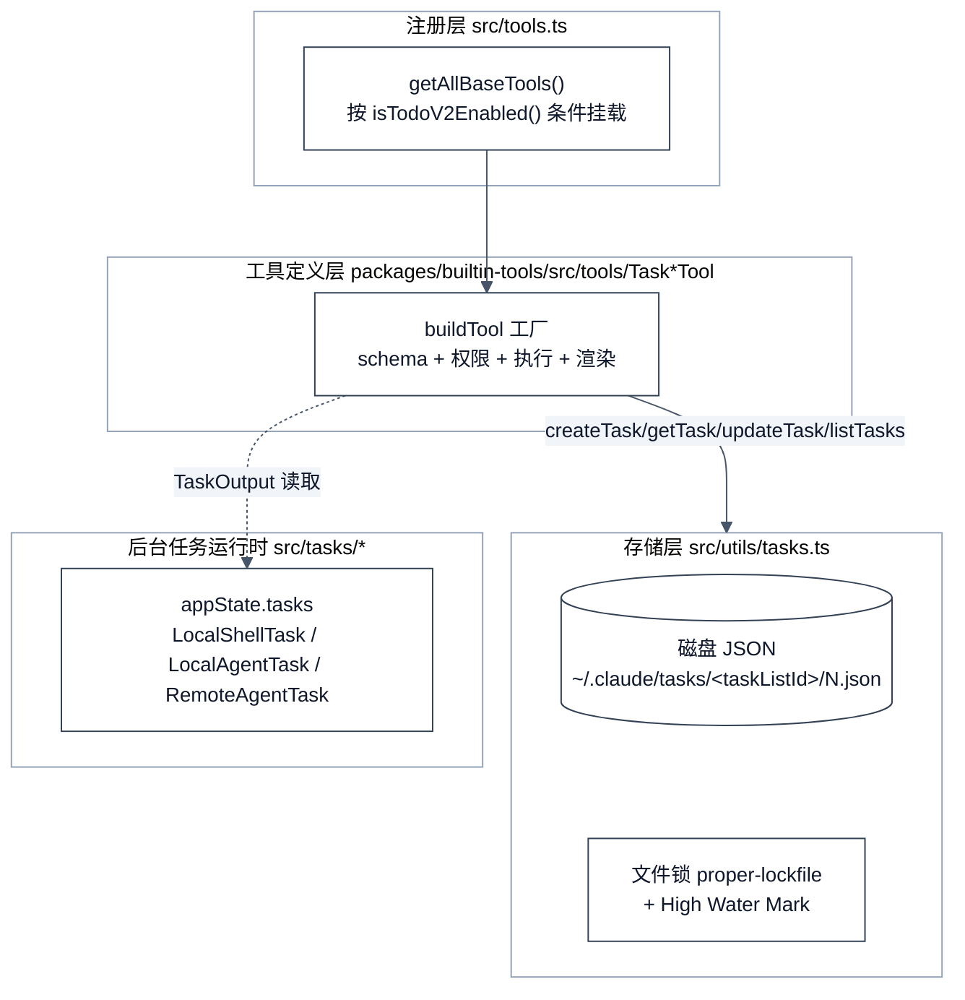
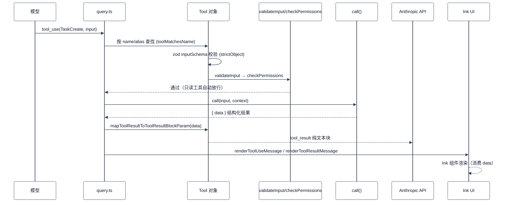
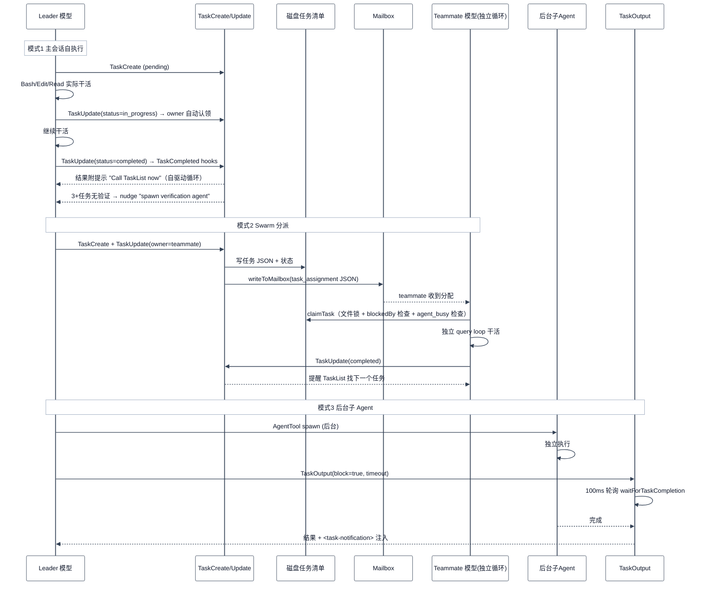

# Task 工具体系源码笔记

> 来源：与 AI 的代码讲解问答整理。覆盖 `TaskCreateTool` / `TaskGetTool` / `TaskListTool` / `TaskUpdateTool` / `TaskOutputTool` 的架构、实现方法、设计模式与任务执行流程。

---

## 一、先分清两组工具（易混淆）

| 工具 | 存储位置 | 用途 |
|---|---|---|
| `TaskCreate/Get/List/Update` | 磁盘 JSON 文件（`~/.claude/tasks/<taskListId>/N.json`） | 持久化任务清单，供 agent 团队（swarm）共享、跨进程协作 |
| `TaskOutput` | 内存 AppState（`appState.tasks`） | 读取运行中后台任务（后台 shell / 子 agent / 远程会话）的输出，与任务清单无关 |

### 模块架构图

---

## 二、整体架构三层职责

1. **注册层**（`src/tools.ts`）：显式组装工具列表，按 `isEnabled()` / `isTodoV2Enabled()` 做特性开关（非交互会话默认关闭 Task 工具、保留 TodoWrite；`CLAUDE_CODE_ENABLE_TASKS=1` 可强开）。
2. **工具定义层**：每个工具一个目录，三个文件：
   - `constants.ts` — 工具名常量
   - `prompt.ts` — 给模型看的 description/prompt（prompt 与逻辑分离）
   - `TaskXxxTool.ts` — 定义本体（`buildTool({...})`）
3. **存储层**（`src/utils/tasks.ts`）：Repository 模式，CRUD 全在这里，工具层不碰文件系统。

### 一次 tool_use 的完整生命周期（时序图）

**双通道设计**：`data` 给 UI（React 组件消费结构化数据），`mapToolResult...` 给模型（纯文本），互不污染。

---

## 三、TaskCreateTool.ts:81-137 逐段逻辑

### 1. 创建任务（L81-90）

- `getTaskListId()` 决定存哪个清单，优先级：`CLAUDE_CODE_TASK_LIST_ID` 环境变量 → teammate 团队名 → leader 团队名 → session ID
- 新任务固定：`pending`、无 owner、无阻塞关系
- `createTask` 内部：文件锁 → 读 high water mark → 自增 ID → 写 `<id>.json`

### 2. 执行 TaskCreated hooks（L92-108）

- async generator 逐个消费多个异步 hook 的结果
- 只收集 `blockingError`；`context?.abortController?.signal` 支持中断级联取消

### 3. 补偿回滚（L110-113）

- hook 否决 → `deleteTask` 删掉刚创建的任务（Saga 补偿），再抛错
- 对外语义："创建失败、无残留"

### 4. UI 联动 + 返回（L115-129）

- `expandedView: 'tasks'` 自动切到任务面板；幂等保护（已是 tasks 视图返回原对象）
- 返回结构化 `{ data: { task: { id, subject } } }`，由 `mapToolResultToToolResultBlockParam` 转成 `Task #1 created successfully: xxx` 回传 API

---

## 四、任务创建后，模型怎么执行？

**关键认知：任务工具本身不执行任何工作，它只是共享的状态账本。** 执行仍是模型在对话循环里调其它工具完成。

### 执行流程时序图（三种模式）

### 推动模型行为的机制（都在 `TaskUpdateTool.ts`）

| 机制 | 位置 | 作用 |
|---|---|---|
| 自动认领 | L188-199 | teammate 标 `in_progress` 未写 owner 时自动填 `getAgentName()` |
| 完成提醒 | L387-394 | tool_result 追加 "Call TaskList now..." 驱动自驱动循环 |
| 验证 nudge | L333-349 | 3+ 任务无验证任务 → 注入 "spawn the verification agent" |
| 完成 hooks | L232-264 | `status=completed` 跑 hooks，否决则状态不变 |
| mailbox 分派 | L277-298 | owner 变更时写 `task_assignment` JSON 到队友邮箱 |

**一句话总结**：Task 工具 = 共享白板；执行 = 模型自己的工具调用循环；工具通过 tool_result 里注入的提示文本间接驱动模型的下一步行为——"用自然语言编程模型行为"的典型手法。

---

## 五、从 0 到 1 实现步骤

1. **数据模型与存储**（`src/utils/tasks.ts`）：zod 定义 `TaskSchema` → `getTaskListId()` 解析链 → CRUD（写 `jsonStringify`，读后 `safeParse`，坏数据返回 null 不 throw）
2. **工具定义**：`constants.ts` 工具名 → `inputSchema`（`z.strictObject` + 每字段 `.describe()`，describe 会进 API JSON Schema）+ `outputSchema` → `buildTool({...})`：`call()` 调存储层，`mapToolResult...` 生成模型文本
3. **注册**：`src/tools.ts` import + 按 `isEnabled` 条件加入 `getAllBaseTools()`
4. **UI**（可选）：`renderToolUseMessage` / `renderToolResultMessage` 返回 Ink 组件
5. **测试**：存储层纯函数直接测，不需要 mock

---

## 六、设计模式与编程技巧清单

| # | 模式/技巧 | 体现 |
|---|---|---|
| 1 | Builder 工厂 + 默认值合并 | `buildTool`：`ToolDef` = `Omit & Partial<Pick<>>` 类型层镜像 `{...TOOL_DEFAULTS, ...def}`；`satisfies ToolDef<Input, Output>` 双向类型推断 |
| 2 | Repository + 文件锁 | `proper-lockfile` 独占锁 + 重试退避（预算按 10 并发 agent 算）；锁内 `updateTaskUnsafe` 变体避免重入死锁 |
| 3 | High Water Mark | `.highwatermark` 防删除后 ID 复用；`findHighestTaskId = max(文件, 水位线)` |
| 4 | 观察者 | `createSignal()` + `onTasksUpdated`；emit 包 try/catch（订阅者失败不影响主操作） |
| 5 | 补偿事务（Saga） | hook 否决 → `deleteTask` 回滚 |
| 6 | 惰性初始化 | `lazySchema` + getter `get inputSchema()` 按需求值，60+ 工具 schema 不在模块加载时全量构造 |
| 7 | 策略/类型收窄分发 | `TaskOutputTool.getTaskOutputData` 按 `task.type` discriminated union 分发 |
| 8 | 向后兼容别名 | `aliases: ['AgentOutputTool', 'BashOutputTool']` |
| 9 | 能力标志位协议 | `isReadOnly/isConcurrencySafe/isDestructive/shouldDefer/interruptBehavior` — 权限、并发、UI 靠谓词决策，开闭原则 |
| 10 | 包边界与深导入 | exports map `./tools/*` 深导入，避免 barrel 拉入全部 60 个工具，利于 tree-shaking |

**总纲**：工具层只做"协议适配"（zod 进、结构化 data 出、文本回 API），业务全在存储层，框架能力（权限/并发/渲染/hooks）靠 `Tool` 接口的标志位方法声明式接入。练手建议：先抄 `TaskGetTool`（最简单：只读 + 无状态）做变体，再逐步加锁、hooks 和 UI。
